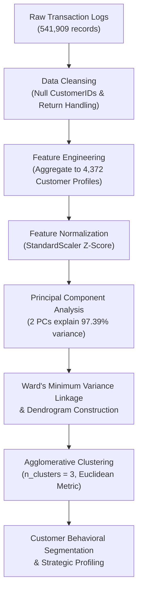

# E-Commerce Customer Segmentation Using Hierarchical Agglomerative Clustering & Dendrogram Analysis

[](https://www.python.org/)
[](https://scikit-learn.org/)
[](https://scipy.org/)
[](https://pandas.pydata.org/)
[](https://matplotlib.org/)
[](LICENSE)

An enterprise customer segmentation system built on transnational e-commerce retail data. The project aggregates raw transactions into customer behavioral profiles, applies **StandardScaler** and **PCA** (capturing **97.39% of total variance**), constructs full **Ward Linkage Dendrograms**, and partitions 4,372 customers into distinct clusters via **Agglomerative Hierarchical Clustering**.

---

## Table of Contents

- [Overview](#overview)
- [Key Highlights](#key-highlights)
- [Workflow Architecture](#workflow-architecture)
- [Dataset & Behavioral Aggregation](#dataset--behavioral-aggregation)
- [Dimensionality Reduction (PCA)](#dimensionality-reduction-pca)
- [Hierarchical Linkage & Dendrogram Analysis](#hierarchical-linkage--dendrogram-analysis)
- [Agglomerative Clustering & Customer Profiles](#agglomerative-clustering--customer-profiles)
- [Repository Structure](#repository-structure)
- [Getting Started](#getting-started)
- [Author](#author)

---

## Overview

In large-scale transnational e-commerce, raw transaction ledgers contain hundreds of thousands of line items that do not directly reveal customer persona patterns. By engineering customer-level behavioral aggregations (purchase volume, monetary spend, and transaction frequency) and applying **Hierarchical Agglomerative Clustering**, businesses can uncover bottom-up customer relationships without pre-specifying arbitrary cluster centers.

This project analyzes over 540,000 transaction records from the Online Retail dataset, cleans and aggregates them into 4,372 customer profiles, and executes complete dendrogram analysis using Ward's minimum variance method.

---

## Key Highlights

- **Massive Transaction Processing**: Cleaned over 541,000 raw transactional line items into 406,829 valid purchase records.
- **Customer Behavioral Aggregation**: Synthesized individual transaction records into customer-level behavioral vectors: Total Quantity, Total Monetary Value, and Invoice Frequency.
- **High-Variance PCA Decomposition**: Reduced feature dimensionality into 2 principal components that explain **97.39% of all underlying variance** ($PC_1: 79.65\%$, $PC_2: 17.74\%$).
- **Ward Linkage Dendrogram**: Constructed a complete agglomerative tree via SciPy `linkage(method='ward')`, visualizing Euclidean distance merges to mathematically validate cluster boundaries.
- **Agglomerative Clustering**: Segmented 4,372 customer accounts into 3 distinct customer cohorts for targeted lifecycle marketing.

---

## Workflow Architecture



---

## Dataset & Behavioral Aggregation

The raw transaction dataset was transformed into customer-level records ($N = 4,372$):

| Customer Metric | Aggregation Method | Business Impact |
| :--- | :--- | :--- |
| **`Quantity`** | Sum of purchased product quantities | Measures bulk buying tendency |
| **`Total Spend`** | Sum of $(\text{Quantity} \times \text{UnitPrice})$ | Monetary lifetime customer value (LTV) |
| **`# of Invoices`** | Count of distinct `InvoiceNo` per customer | Purchase frequency and loyalty |

---

## Dimensionality Reduction (PCA)

Before tree construction, the standardized customer vectors were transformed using **Principal Component Analysis (PCA)**:

- **Component 1 ($PC_1$)**: Captures **79.65%** of variance (primary purchasing scale and spend volume).
- **Component 2 ($PC_2$)**: Captures **17.74%** of variance (order frequency vs. basket size contrast).
- **Cumulative Explained Variance**: **97.39%**, preserving near-complete statistical information in a compressed 2D space.

---

## Hierarchical Linkage & Dendrogram Analysis

Agglomerative hierarchical clustering employs a bottom-up strategy where each observation starts in its own cluster, and pairs of clusters are iteratively merged to minimize variance:

$$\Delta(A, B) = \frac{n_A n_B}{n_A + n_B} ||\mu_A - \mu_B||_2^2$$

- Generated complete tree visualization using `scipy.cluster.hierarchy.dendrogram`.
- The largest vertical distance gap across branches established **$K = 3$** as the natural cut point.

---

## Agglomerative Clustering & Customer Profiles

Using `AgglomerativeClustering(n_clusters=3, metric='euclidean', linkage='ward')`, the customer base of 4,372 accounts was categorized into three actionable segments:

1. **High-Value VIP / Wholesale Buyers**: Extreme purchase quantities and highest monetary contribution; priority tier for loyalty incentives.
2. **Regular Active Customers**: Consistent order frequencies and moderate average order values; ideal targets for recurring subscriptions and upsells.
3. **Occasional / Low-Frequency Shoppers**: Infrequent single-item orders; candidates for targeted re-engagement campaigns and promotional discounts.

---

## Repository Structure

```plaintext
hierarchical-clustering-customer-segmentation/
├── hierarchical_clustering_customer_segmentation.pdf   # Complete project report & exported notebook
└── README.md                                           # Project documentation
```

---

## Getting Started

### Prerequisites

- Python 3.8+
- Scikit-Learn
- SciPy
- Pandas
- NumPy
- Matplotlib

### Environment Setup

```bash
pip install pandas numpy scikit-learn scipy matplotlib
```

### Viewing Project Documentation

Inspect the complete experimental pipeline, code executions, dendrogram plots, and cluster distributions in [`hierarchical_clustering_customer_segmentation.pdf`](./hierarchical_clustering_customer_segmentation.pdf).

---

## Author

**Umair Nawaz**  
- GitHub: [@Umair-Nawaz0](https://github.com/Umair-Nawaz0)
