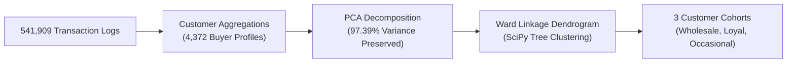

# E-Commerce Customer Segmentation Using Hierarchical Clustering & Dendrogram Analysis

[](https://www.python.org/)
[](https://scikit-learn.org/)
[](https://scipy.org/)
[](https://pandas.pydata.org/)
[](https://matplotlib.org/)
[](LICENSE)

---

### The Problem It Solves
Raw e-commerce transaction logs contain hundreds of thousands of individual purchases that reveal little about overarching customer value. Forcing shoppers into arbitrary, fixed cluster counts often distorts natural hierarchical relationships. Retailers need an objective, bottom-up method to discover natural loyalty tiers directly from purchasing behavior.

### How It Solves It
Aggregates over 540,000 transaction records into customer-level behavioral profiles, compresses feature variance into 2 principal components using PCA (**explaining 97.39% of variance**), and applies **Ward's Minimum Variance Linkage** with Agglomerative Hierarchical Clustering to construct tree dendrograms and segment 4,372 customer accounts into 3 distinct cohorts.

---

### Quick Summary: What It Has Done & What It Does
*(Fast overview for users who want the essential takeaways without reading the full report)*

- **What It Has Done**:
  - Cleaned and aggregated 541,909 raw invoice line items into 4,372 clean customer profiles (measuring total quantity, total monetary spend, and transaction frequency).
  - Executed Principal Component Analysis (PCA), preserving **97.39% of all underlying variance** in 2 components.
  - Built SciPy Ward linkage dendrograms to visualize pairwise Euclidean distance merges and mathematically justify 3 natural customer tiers.
- **What It Does**:
  - Automatically classifies shoppers into three commercial segments:
    - **Cohort 1: High-Volume Wholesale / B2B Clients** (Bulk volume, maximum monetary spend).
    - **Cohort 2: Consistent Loyal Retailers** (High purchase frequency, steady repeat value).
    - **Cohort 3: Occasional Shoppers** (Lower frequency, seasonal promotional targets).
  - Gives e-commerce growth teams exact customer segments for targeted retention, loyalty rewards, and automated email campaigns.

---

## Segment Profiles & Behavioral Aggregation

| Cluster Tier | Customer Cohort | Key Behavioral Indicators | Targeted Action |
| :---: | :--- | :--- | :--- |
| **Tier 1** | **Wholesale Whales / VIPs** | Extreme bulk quantities + highest total spend | Dedicated account managers & wholesale pricing |
| **Tier 2** | **Loyal Repeat Shoppers** | High invoice frequency + consistent basket sizes | Early access to new arrivals & loyalty tier perks |
| **Tier 3** | **Occasional Buyers** | Single or infrequent transactions | Win-back discount codes & seasonal reminders |



---

## Quick Start

```bash
# Clone the repository
git clone https://github.com/Umair-Nawaz0/hierarchical-clustering-customer-segmentation.git
cd hierarchical-clustering-customer-segmentation

# Install dependencies
pip install pandas numpy scikit-learn scipy matplotlib
```

The full dendrogram trees and clustering notebook report are available in [`hierarchical_clustering_customer_segmentation.pdf`](hierarchical_clustering_customer_segmentation.pdf).

---

## Author

**Umair Nawaz**  
- GitHub: [@Umair-Nawaz0](https://github.com/Umair-Nawaz0)
